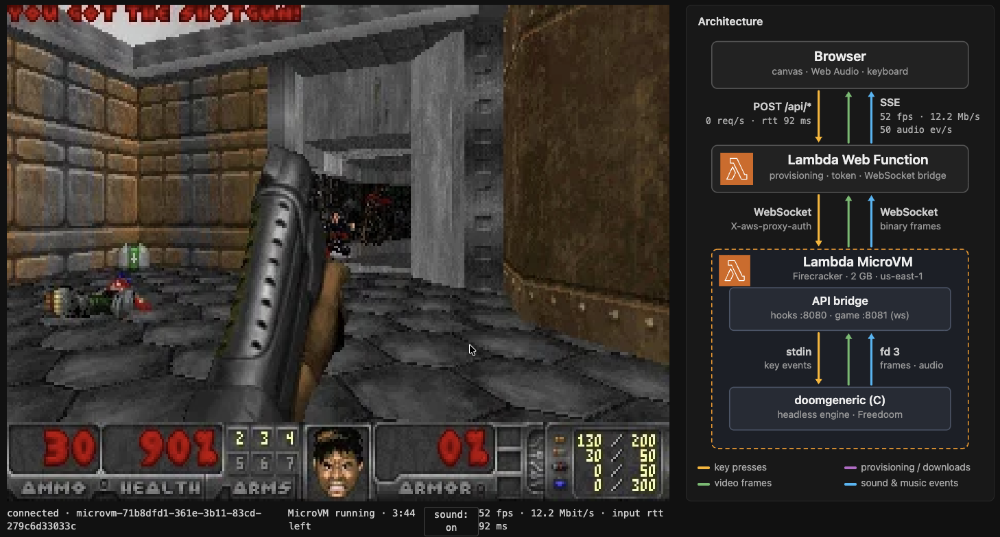

# Can it run DOOM: AWS Lambda MicroVMs

This is an experiment of running Doom on [AWS Lambda MicroVMs](https://docs.aws.amazon.com/lambda/latest/dg/microvms-launching.html), played in a web browser.



> IMPORTANT: This project does not implement authentication. Anyone with your web UI URL can play: every browser tab starts its own MicroVM (up to 10 at a time), and you pay for the AWS resources they use. Be careful who you share it with, and run `make destroy` to clean up after you're done playing.

The game engine runs in a Lambda MicroVM. The browser draws the frames it receives, plays the sounds, and sends key presses back. The browser talks to the web UI with plain POST requests and Server-Sent Events (SSE); the web UI keeps a WebSocket open to the MicroVM.

## How it works

- **Browser** (`webui/public`): a start screen (**Let's play DOOM** with full sound, or with sounds off), which provisions the tab's own MicroVM; then the game on a canvas, sound effects and music with Web Audio (a sound on/off control in the top right corner), and key presses. A live diagram next to the game shows the traffic.
- **webui** (`webui/server.js`): runs on AWS Lambda Web Functions.
  - It starts a MicroVM for each tab (`RunMicrovm`), waits for it to run, and mints an endpoint auth token (`CreateMicrovmAuthToken`). The MicroVM id is the tab's session id: the tab sends it with every request, so any execution environment can serve it (it looks the MicroVM up and mints its own token). Closing or reloading the tab terminates its MicroVM (`TerminateMicrovm`).
  - It refuses to start more than `MAX_MICROVMS` (10) live MicroVMs; the start screen then asks to try later.
  - It bridges the browser's POST/SSE to one WebSocket per MicroVM and execution environment, sending `X-aws-proxy-auth` and `X-aws-proxy-port: 8081`. The browser never sees the token.
  - Its IAM role can run, inspect, resume, terminate and mint tokens only for the Doom image, so a tab can't reach other MicroVMs. `ListMicrovms` and `lambda:PassNetworkConnector` are granted on `*`: `RunMicrovm` passes the default `HTTP_INGRESS` and `INTERNET_EGRESS` connectors, and the ingress check isn't satisfied by the connector ARN.
- **MicroVM** (`doom/`): an ARM64 image that Lambda builds from `doom/Dockerfile` and snapshots once Doom is running, so a new MicroVM starts with the game already going. Inside it:
  - **server** (`doom/server`): a Node.js server. Port **8080** answers Lambda's lifecycle hooks: `/ready` says yes once Doom has drawn a frame and the WebP encoder is warm; `/validate` reads Node, libvips, the engine, the WAD and the music so new MicroVMs prefetch them; `/run` records the MicroVM id. Port **8081** is the game: a WebSocket (`/ws`) plus `GET /sounds` and `GET /music/:lump`. Frames are WebP, sent as binary WebSocket messages.
  - **doomgeneric** (`doom/engine`): a headless build of [doomgeneric](https://github.com/ozkl/doomgeneric) playing [Freedoom](https://freedoom.github.io/). It writes frames and sound/music events to the server and reads keys from it. Music is pre-rendered to MP3 when the image is built.

Every tab is its own game, in its own MicroVM; a reload starts a new one. Locally (`make local`) there's one container, so all tabs share its game.

## Run it

**Locally (Docker):**

```sh
make local    # builds the image, runs it on :8080/:8081, serves the UI on http://localhost:3000
```

Locally there's nothing to provision: the web UI talks straight to the container.

**On AWS (Terraform, `terraform/`):** this uploads `doom/` and has Lambda build the MicroVM image, then creates the roles and the webui web function. An image build takes a few minutes, and any change under `doom/` triggers a new one.

```sh
make deploy   # npm ci + terraform init/apply
```

See the `webui_url` output, open it and press **Let's play DOOM**.

To run the web UI locally but provision the MicroVM on AWS (with your local AWS credentials):

```sh
make webui-run-aws   # http://localhost:3000
```

Once done playing, destroy the resources.

```sh
make destroy
```

**Controls:** WASD move and turn · K fire · L open/use · Shift run · Alt+A/D strafe · 1-7 weapons · Tab map · Esc menu (use the arrows and Enter in menus).

## Limits worth knowing

- A MicroVM lives at most 5 minutes (intentional limit for this experiment, you can set it up to 8 hours). It suspends after 2 minutes without incoming requests and terminates 2 minutes after that (`webui/server.js`). After that, the start screen comes back: press **Let's play DOOM** for a new game.
- The MicroVM has 2 GB, which comes with 1 vCPU and 32 Mbps of endpoint bandwidth, in and out ([MicroVM networking](https://docs.aws.amazon.com/lambda/latest/dg/microvms-networking.html)). The browser sees about 35–52 fps and 7–12 Mbit/s of SSE while moving (base64, so up to about 9 Mbit/s of WebP on the WebSocket). Frames only go to the WebSocket of a webui execution environment that has a browser stream open. 512 MB and 1 GB are noticeably slower, and so is the image build at those sizes.
- Logs: the webui writes to `/aws/lambda/web/lambda-microvm-doom-webui`, the MicroVM (build and runtime) to `/aws/lambda-microvms/lambda-microvm-doom`.

## Credits

- [doomgeneric](https://github.com/ozkl/doomgeneric) by ozkl, derived from id Software's Doom source and Chocolate Doom: GPL-2.0-or-later.
- [Freedoom](https://freedoom.github.io/) game data and music: BSD-3-Clause.
- FluidR3 GM soundfont by Frank Wen: MIT. The music is rendered with it at image build time, using [FluidSynth](https://www.fluidsynth.org/) and [LAME](https://lame.sourceforge.io/); those tools and the soundfont stay in a build stage and are not in the image.
- [sharp](https://sharp.pixelplumbing.com/) (Apache-2.0) with its prebuilt [libvips](https://www.libvips.org/) (LGPL-3.0-or-later), [ws](https://github.com/websockets/ws) (MIT), [AWS SDK for JavaScript](https://github.com/aws/aws-sdk-js-v3) (Apache-2.0).

## License

The code in this repository is MIT-licensed (see [LICENSE](LICENSE)), including the headless platform layer in `doom/engine/`. The repository contains no third-party code or game data: the image build downloads doomgeneric (at the commit pinned in `doom/Dockerfile`) and Freedoom.

The MicroVM image combines several licenses:

- The engine binary, `doomgeneric_headless`, is built from doomgeneric together with `doom/engine/`, so as a whole it is GPL-2.0-or-later.
- Freedoom's `freedoom1.wad` is BSD-3-Clause; its license is included in the image as `/game/COPYING.txt`.
- The music MP3s are rendered from Freedoom's music (BSD-3-Clause) with samples from the FluidR3 GM soundfont (MIT).
- sharp's libvips is LGPL-3.0-or-later; Node.js and the Debian base image come with their own open-source licenses.

The image is built and run in your own AWS account. If you redistribute the image or the engine binary, the GPL requires you to offer the corresponding source: `doom/engine/` plus doomgeneric at the pinned commit.

DOOM is a trademark of its owner. Freedoom is independent free content and contains no data from the original game. AWS, AWS Lambda and the Lambda logo are trademarks of Amazon.com, Inc. or its affiliates. This project is not affiliated with or endorsed by id Software, ZeniMax Media, Microsoft or Amazon Web Services.
